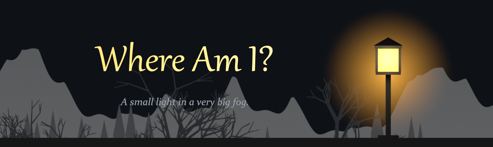
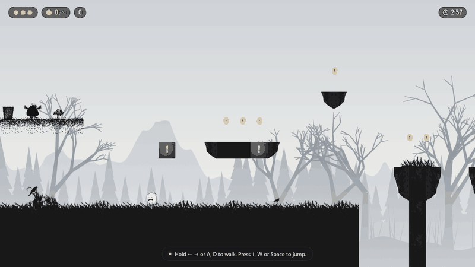
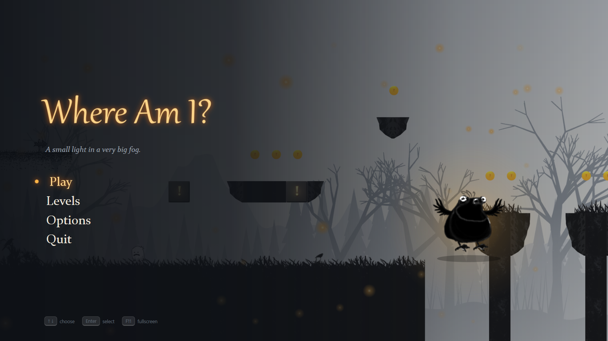
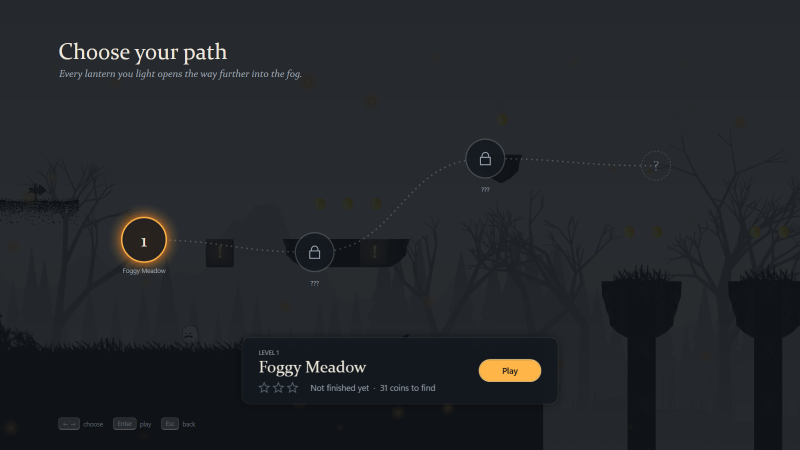
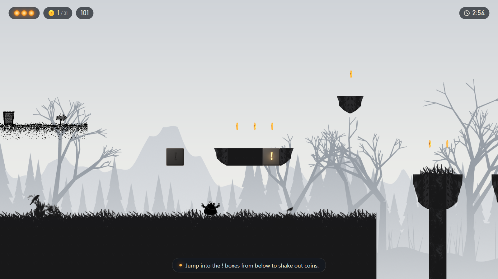
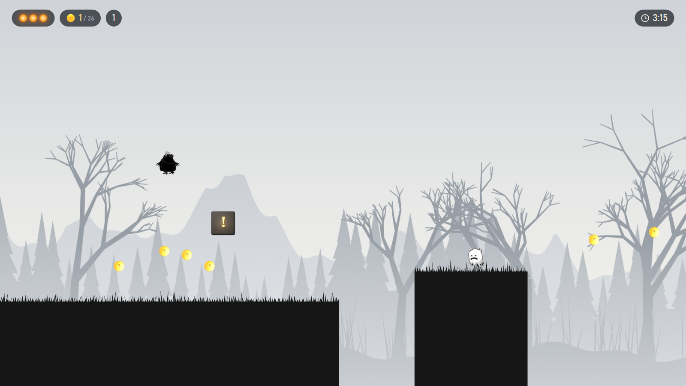
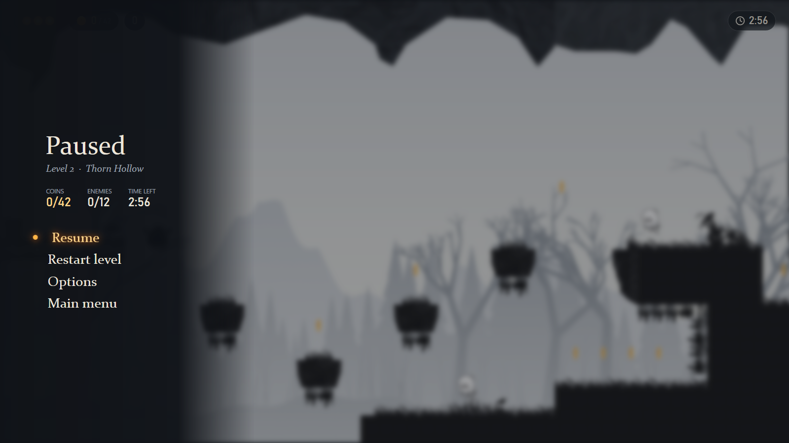
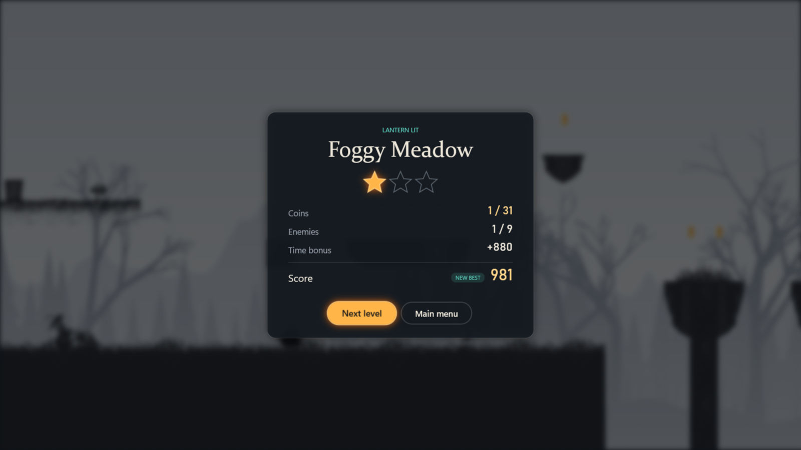

# Where Am I?



[](https://github.com/AleksandarTulic/HCI/actions/workflows/build.yml)

A 2D platformer about a small dark creature that wakes up in a foggy, unfamiliar world.
Follow the trail of light through three levels: collect coins, shake them out of `!` boxes,
stomp on ghosts, ride floating platforms, avoid thorns and light lantern checkpoints on the way.

Written in C# with WPF on .NET 10. Originally made in 2021 as a learning project for a
Human-Computer Interaction course, then rebuilt with a proper game loop, menus, new levels and
art generated in Blender.



| | |
|---|---|
|  |  |
|  |  |
|  |  |

## Features

- **Three levels**, each with its own mood: *Foggy Meadow*, *Thorn Hollow* and *Lantern Marsh*.
- **Any screen size.** The whole height of a level always fits the window; wider screens see more
  of the world. Fullscreen or windowed, any aspect ratio, any DPI.
- **Tight controls.** Variable jump height, coyote time, jump buffering, smooth acceleration.
- **Checkpoints and hints.** Lanterns save your progress through a level; short hints appear
  where they are needed instead of a wall of text.
- **Score and stars.** Coins, defeated enemies and a time bonus add up; collect every coin
  for three stars. Best scores and unlocked levels are saved.
- **Parallax backgrounds** with three layers of fog, pines and bare trees.
- **Menus made for keyboard and mouse**: main menu, a level map, options, pause, results.

## Play

Download the latest `WhereAmI-vX.Y.Z-win-x64.zip` from
[Releases](https://github.com/AleksandarTulic/HCI/releases), unzip it anywhere and run
`WhereAmI\WhereAmI.exe`. It runs on Windows 10 and 11 (64-bit); nothing else needs to be installed.

## Controls

| Key                    | Action                          |
|------------------------|---------------------------------|
| Left arrow / A         | Walk left                       |
| Right arrow / D        | Walk right                      |
| Up arrow / W / Space   | Jump (hold for a higher jump)   |
| Esc                    | Pause / back                    |
| M                      | Music on/off                    |
| F11 / Alt+Enter        | Fullscreen on/off               |
| F3                     | Show hitboxes                   |

Menus work with the arrow keys, Enter and Esc, or with the mouse.

## Build from source

Requirements: Windows 10 or 11 and the [.NET 10 SDK](https://dotnet.microsoft.com/download/dotnet/10.0).

```sh
dotnet run --project src/WhereAmI
```

Useful command-line options:

```sh
dotnet run --project src/WhereAmI -- --windowed            # start in a window
dotnet run --project src/WhereAmI -- --windowed 1280x720   # window with this client size
dotnet run --project src/WhereAmI -- --level 3             # skip the menus and play level 3
dotnet run --project src/WhereAmI -- --no-save             # fresh settings and progress, nothing is saved
```

In Debug builds, F8 finishes the current level and F7 loses a life, to test the menus quickly.

Settings and progress are stored in `%AppData%\WhereAmI\`. If the game ever crashes, the details
are written to `crash.log` in the same folder.

## Project layout

```
src/WhereAmI/
  Core/        Game loop (fixed 120 Hz update), asset paths, settings and progress
  Game/        Game rules: world, player, enemies, pickups, session (no WPF code)
  Input/       Keyboard to game action mapping
  Levels/      XML level loader
  Rendering/   Sprites, animations, camera, parallax and the surface that draws the world
  Audio/       Music, sound effects and generated menu sounds
  UI/          Theme, menu screens and HUD
  Assets/      Sprites, backgrounds, audio and levels
docs/          Level format, screenshots and images
tools/
  blender/          Scripts that render the 3D props, parallax layers, icon and banner
  smoke-test.ps1    Starts the game, optionally presses keys, and saves screenshots
```

## Making levels

Levels are plain XML files in `src/WhereAmI/Assets/levels/`. The format is described in
[docs/level-format.md](docs/level-format.md). Press **F3** in the game to see every hitbox,
and start the game with `--level N` to jump straight into the level you are editing.

## Art

The coin, the boxes, the goal gate, the lanterns, the parallax layers, the icon and the banner
are generated by Python scripts for Blender, see [tools/blender](tools/blender/README.md).
Nothing is modelled by hand, so every asset can be tweaked in code and rendered again.

## Releases

Releases are built automatically by GitHub Actions when a version tag is pushed:

```sh
git tag v1.0.0
git push origin v1.0.0
```

Versions follow `MAJOR.MINOR.PATCH`: fixes raise PATCH (`v1.0.1`), new content such as a level
raises MINOR (`v1.1.0`), and changes that break saved progress raise MAJOR (`v2.0.0`).
