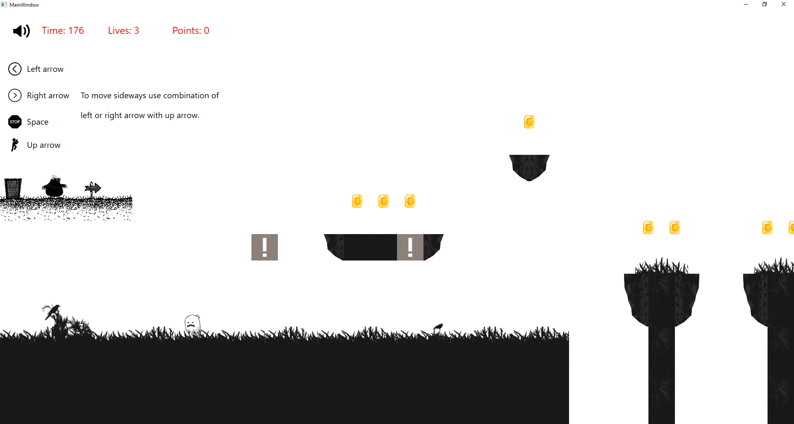
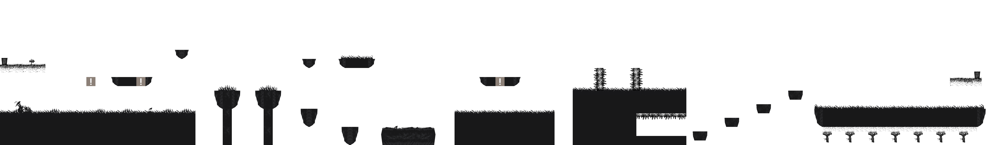
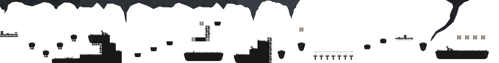

# Where Am I?

A 2D side-scrolling platformer in a black-and-white silhouette style, written in C# with WPF.

A small dark creature wakes up in a foggy, unfamiliar world. Collect coins, hit the `!` boxes,
stomp on ghosts and avoid spikes. Reach the end of each level before the time runs out.

> **Status:** being refactored. The game was originally written in 2021 as a learning project
> for a Human-Computer Interaction course. It is being moved to .NET 10, restructured, and made
> to run at any screen resolution.



## Requirements

- Windows 10 or 11
- [.NET 10 SDK](https://dotnet.microsoft.com/download/dotnet/10.0)

## Build and run

```sh
dotnet run --project src/WhereAmI
```

## Controls

| Key                    | Action                          |
|------------------------|---------------------------------|
| Left arrow / A         | Walk left                       |
| Right arrow / D        | Walk right                      |
| Up arrow / W / Space   | Jump (hold for a higher jump)   |
| Esc                    | Pause / back                    |
| M                      | Music on/off                    |
| F11 / Alt+Enter        | Fullscreen on/off               |
| F3                     | Show hitboxes                   |

Menus work with the keyboard (arrows, Enter, Esc) and the mouse.

## Screen resolution

The game runs at any resolution and aspect ratio. The full height of a level always fills the
window, and wider screens see more of the level to the sides. Menus and the HUD scale with the window.

## Settings and progress

Settings (volume, fullscreen, screen shake) and progress (unlocked levels, best scores and stars)
are saved in `%AppData%\WhereAmI\` as small XML files.

## Command-line options

```sh
dotnet run --project src/WhereAmI -- --windowed            # start in a window
dotnet run --project src/WhereAmI -- --windowed 1280x720   # window with this client size
dotnet run --project src/WhereAmI -- --no-save             # fresh settings and progress, nothing is saved
```

In Debug builds, F8 finishes the current level and F7 loses a life, to test the menus quickly.

## Project layout

```
src/WhereAmI/
  Core/        Game loop (fixed 120 Hz update), asset paths, settings and progress
  Game/        Game rules: world, player, enemies, pickups, session (no WPF code)
  Input/       Keyboard to game action mapping
  Levels/      XML level loader
  Rendering/   Sprite cache, animations, camera and the surface that draws the world
  Audio/       Music, sound effects and generated menu sounds
  UI/          Theme, menu screens and HUD
  Assets/      Sprites, backgrounds, audio and levels
docs/          Screenshots and the level format
tools/         Developer scripts
```

Levels are plain XML files, described in [docs/level-format.md](docs/level-format.md).

## Levels

| Level 1 | Level 2 |
|---------|---------|
|  |  |
